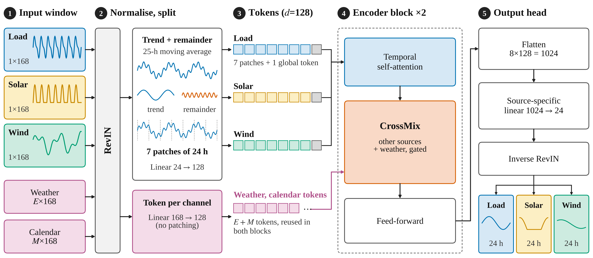

# GateXer: Gated Joint Forecasting of Electricity Load, Solar and Wind

GateXer forecasts the next 24 hours of **electricity load, solar generation and wind generation together**.
It starts as three independent forecasters and learns, through a small router and zero-initialised gates, **where sharing information with the other sources and with the weather actually lowers the error**. Nothing is forced to share.

> **Status:** M.Tech research project at the National Institute of Technology, Rourkela. The manuscript is in preparation.
> Author: Alok Kumar. Supervisor: Prof. Manmath Sahoo (Department of Computer Science and Engineering).



## Why this project

Joint load/solar/wind models usually share one encoder between all targets. That helps some targets and can hurt others (negative transfer). Most are also tested on one dataset against older baselines. GateXer asks a narrower question: **can a model learn where to share, and is that better than fixed sharing?** We test it on 11 grids against the official PatchTST, iTransformer and TimeXer implementations under one protocol.

## Main results

Lower normalised MAE (nMAE = MAE / mean actual) is better. "Gain" is the relative error reduction of a 3-seed GateXer ensemble over the strongest official baseline (also a 3-seed ensemble) on the same grid. 95% paired-bootstrap intervals are in `docs/results_tables.md`.

| Grid | GateXer nMAE | Strongest baseline | Its nMAE | Gain |
|---|---|---|---|---|
| ERCOT (Texas) | 0.1497 | iTransformer | 0.1611 | 7.1% |
| CAISO (California) | 0.1451 | iTransformer | 0.1542 | 5.9% |
| SWPP | 0.1548 | iTransformer | 0.1689 | 8.4% |
| MISO | 0.1650 | TimeXer | 0.1752 | 5.8% |
| Germany | 0.1795 | iTransformer | 0.1884 | 4.8% |
| Spain | 0.1440 | iTransformer | 0.1496 | 3.8% |
| France | 0.1681 | TimeXer | 0.1723 | 2.5% |
| Denmark | 0.2404 | TimeXer | 0.2463 | 2.4% |
| Portugal | 0.1953 | iTransformer | 0.2032 | 3.9% |
| Austria | 0.2587 | TimeXer | 0.2653 | 2.5% |
| Greece | 0.1787 | iTransformer | 0.1891 | 5.5% |

* GateXer has the lowest error on all 11 grids (mean gain 4.8%, range 2.4 to 8.4%). Every bootstrap interval is above zero.
* Mean gains by target: solar 8.6%, load 6.2%, wind 2.3%.
* **A simple "yesterday-correction"** (predict the change from the same hour 24 h earlier) helps every model. When all models use it, **GateXer ties the best baseline (TimeXer)**: differences of 0.1 to 1.4% with intervals that include zero on all five grids tested. We report this as a tie, not a win.
* An ablation separates sharing with other sources from sharing with weather. Both contribute, in different amounts on different grids (`docs/RESULTS.md`).
* **Limitation:** on the all-India series, where the solar level tripled over the years, GateXer has no advantage (-0.1%, interval [-4.0, 3.5]). It is reported as a stress case and not included in the average.

More detail, figures and caveats: [`docs/RESULTS.md`](docs/RESULTS.md) and [`docs/LIMITATIONS.md`](docs/LIMITATIONS.md).

## How it works

1. **Normalise and split:** each window is normalised by its own mean and std (RevIN); a 25-hour moving average splits trend from remainder.
2. **Tokenise:** each source's 168-hour history becomes 7 patches of 24 h plus one global token; each weather or calendar channel becomes one token.
3. **Two encoder blocks:** temporal self-attention within each source, then **CrossMix**, then a feed-forward network.
4. **CrossMix:** attention across sources, attention onto weather/calendar tokens, a router (none / sources / weather) and gates `tanh(alpha)` that start at zero, so each block starts as the identity.
5. **Head:** a source-specific linear layer gives the next 24 hours. Training uses MAE per source balanced by FAMO.

The model has 632,794 parameters at width 128 and trains in about 100 seconds on a Kaggle T4. See [`docs/METHOD.md`](docs/METHOD.md).

## Repository layout

```
gatexer/        model, training, baselines, experiment runner (main code)
  tslib_vendor/   official TimeXer / PatchTST / iTransformer code from Time-Series-Library (MIT)
data_prep/      scripts that turn the raw public datasets into clean hourly CSVs
analysis/       aggregation and paired-bootstrap scripts, table generator
results/        per-run results (results_all.csv) and bootstrap outputs used in the paper
figures/        final figures (PDF/PNG/SVG) and the scripts that draw the results figures
docs/           method, protocol, results, data, reproduction guide, limitations
tests/          fast CPU tests (zero-initialised gates, shapes, FAMO, end-to-end smoke run)
```

## Quick start

```bash
python -m venv .venv && source .venv/bin/activate      # Windows: .venv\Scripts\activate
pip install -r requirements.txt

# 1. tests (a few seconds to a minute on CPU)
pip install pytest && pytest -q tests

# 2. a 1-epoch smoke run on synthetic data (checks that everything works; the numbers mean nothing)
cd gatexer && python make_synth.py
python train.py --csv synth.csv --exog temp,cloud,wspeed --preset full --decomp 25 --ple 0 --net 0 --ramp 0 \
                --epochs 1 --bs 128 --max_train_windows 800 --out smoke.json
```

Reproducing the real experiments (data download, weather, the exact commands for every stage) is in [`docs/REPRODUCE.md`](docs/REPRODUCE.md). Raw datasets are **not** redistributed here; see [`docs/DATA.md`](docs/DATA.md) for sources and licences.

## Experimental protocol in brief

* Task: hourly load, solar and wind; lookback 168 h, horizon 24 h; chronological 70/10/20 split; standardisation from training data only.
* All model choices (width, lookback, variants) are made on **validation** data. The test set is read once per run.
* Every baseline receives the inputs it was designed for and the same tuning grid; baselines are the official Time-Series-Library implementations.
* 3 seeds per model, 3-seed ensembles, paired bootstrap with 24-phase averaging for the intervals.
* A model with the yesterday-correction is only ever compared with other corrected models.

Details: [`docs/PROTOCOL.md`](docs/PROTOCOL.md).

## Citation

The manuscript is in preparation. Until it is available, please cite the repository (see `CITATION.cff`).

## Acknowledgements

Built on ideas from TimeXer, PatchTST, iTransformer, DLinear, RevIN, FAMO, TimeFilter and Gateformer. The baselines use the official [Time-Series-Library](https://github.com/thuml/Time-Series-Library) code (MIT, vendored in `gatexer/tslib_vendor`). Data from the Open Power System Data project, the U.S. EIA, Grid-India and the Open-Meteo archive (ERA5-based); see `docs/DATA.md`.

## Licence

Code: MIT (see `LICENSE`). Vendored Time-Series-Library code keeps its own MIT licence in `gatexer/tslib_vendor/LICENSE_TSLib_MIT`. Datasets keep their original licences.
