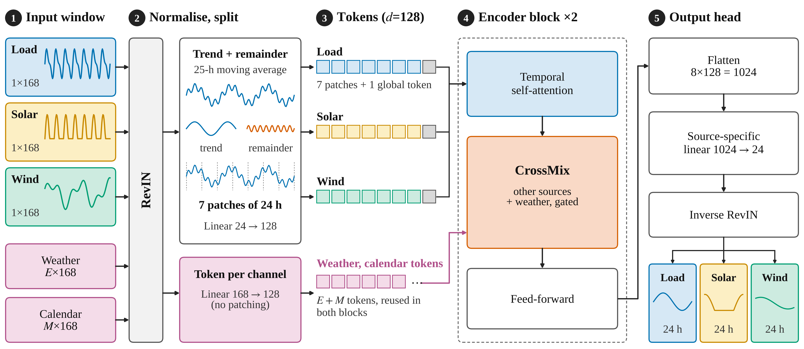

# Method

## Problem

Given the last `L = 168` hours of load, solar and wind for one grid, plus weather and calendar channels, predict the next `H = 24` hours of the three sources. Metric: **nMAE = MAE / mean(actual)** per source, averaged over the three.

## Architecture



**Input handling**
* RevIN: every window of the targets and weather channels is normalised by its own mean and std; the output is de-normalised with the same statistics. Calendar channels (sin/cos of hour, weekday, day of year) are not normalised.
* Optional decomposition (`--decomp 25`): a 25-hour moving average separates trend and remainder before patching. In our ablation it gives no measurable benefit; it is kept as a neutral component.

**Tokens** (width `d = 128`)
* Each source: 7 non-overlapping patches of 24 h, each mapped by a linear layer, plus 1 learned global token, so 8 tokens per source.
* Each weather/calendar channel: its whole 168 h history mapped by `Linear(168 -> d)` to one token (computed once, reused in both blocks).
* Fixed sinusoidal position code on patches and a learned source code per source.

**Encoder block (x2).** Post-norm, 4 heads, FFN `d -> 256 -> d`:
1. Temporal self-attention within each source.
2. **CrossMix** (below).
3. Feed-forward network.

**CrossMix** (`gatexer/model.py`, class `CrossMix`)
* *Source mixing:* at each token position, a source's token attends to the same position in the other sources (own source masked out).
* *Weather mixing:* all 8 tokens of a source attend to the weather and calendar tokens. (TimeXer lets only the global token do this.)
* *Router:* `Linear(d -> 3)` followed by softmax gives weights for none / sources / weather. Zero-initialised.
* *Gates:* one learnable `alpha` per source per block for each of the two routes, initialised at **zero**.

```
y = x + tanh(alpha_src) * g_sources * out_src + tanh(alpha_ex) * g_weather * out_ex
```

With `alpha = 0` the update is `y = x`: each block starts as three independent forecasters. The optimiser opens a gate only if doing so lowers the training loss. This is a guarantee about **initialisation**, not about the final trained model. A small balance loss (weight 0.01, `var/mean^2` of the average router usage) discourages the router from using a single route.

**Head.** The 8 tokens x 128 = 1024 values of a source go through a source-specific linear layer to 24 outputs, then are de-normalised.

## Training

* Loss: MAE per source, balanced by **FAMO** (Liu et al., NeurIPS 2023): task weights `z = softmax(w)`, `w` updated with Adam (lr 0.025). One extra forward pass per step (about 4/3 of the normal cost).
* Adam, lr 1e-3, batch size 128, at most 30 epochs, early stopping on validation (patience 5), gradient clipping 1.0.
* Size: 632,794 parameters at width 128 (3 sources, 4 weather and 6 calendar channels); about 100 s per run on a Kaggle T4.

## Final recipe

`--preset full --decomp 25 --ple 0 --net 0 --ramp 0` (preset name `gx` in `gatexer/run_experiments.py`). The code also contains options that were tried and dropped because they gave no consistent gain: `--ple` (progressive layered extraction experts), `--net` (net-load loss head), `--ramp` (ramp-weighted loss). They are kept so that the ablation runs can be reproduced.

## Yesterday-correction (`--snb 1`)

Instead of predicting the value directly, a model predicts a scaled correction on top of the actual value 24 hours before the target hour: `y_hat(t+h) = sigma * y_tilde + y(t+h-24)`. It is applied to GateXer, the no-sharing control, PatchTST, iTransformer and TimeXer (not to DLinear and seasonal naive). It is a general technique and not specific to GateXer; results under it are reported separately and compared only with other corrected models.

## Complexity (orders of growth)

With `T = 8` tokens per source, `S = 3` sources, `M` weather and calendar tokens and width `d`, one block costs roughly `O(S T^2 d)` for temporal attention, `O(T S^2 d)` for source mixing, `O(S T M d)` for weather mixing and `O(S T d^2)` for the FFN. Patching keeps `T` small, so the `d^2` terms dominate: about 12.4 million multiply-accumulates per window.
