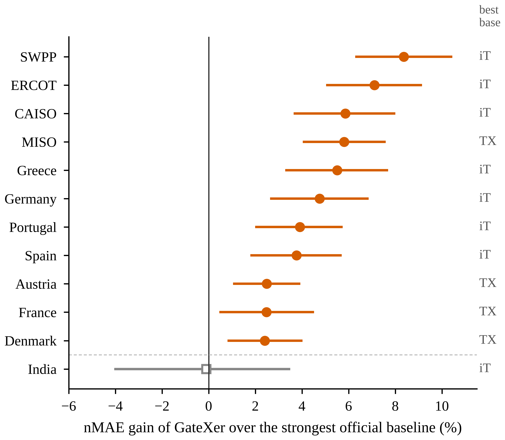
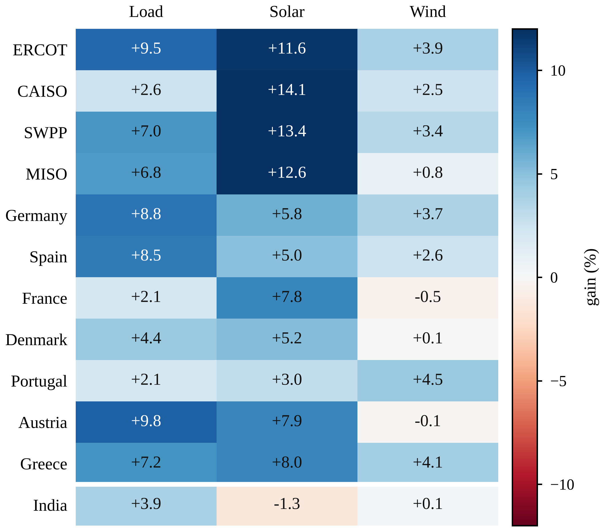
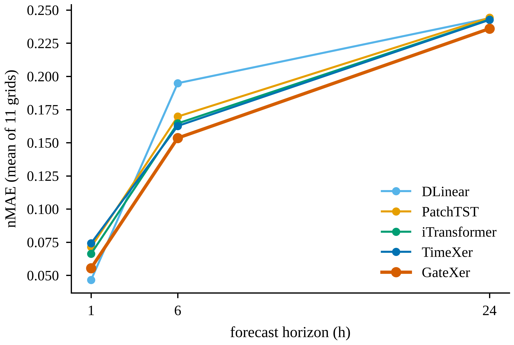
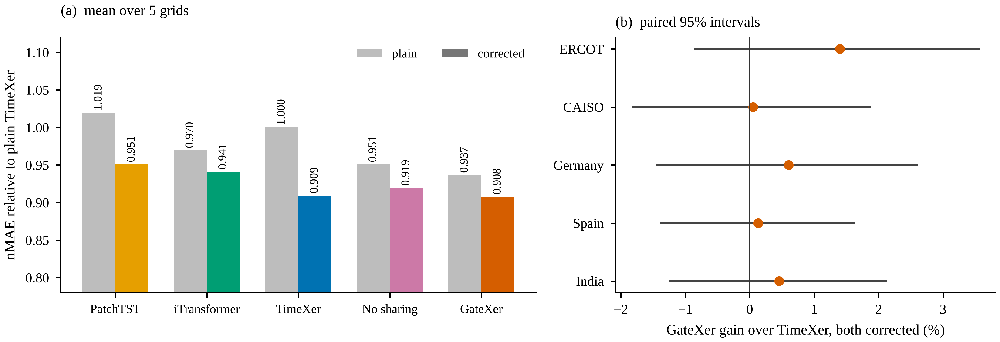
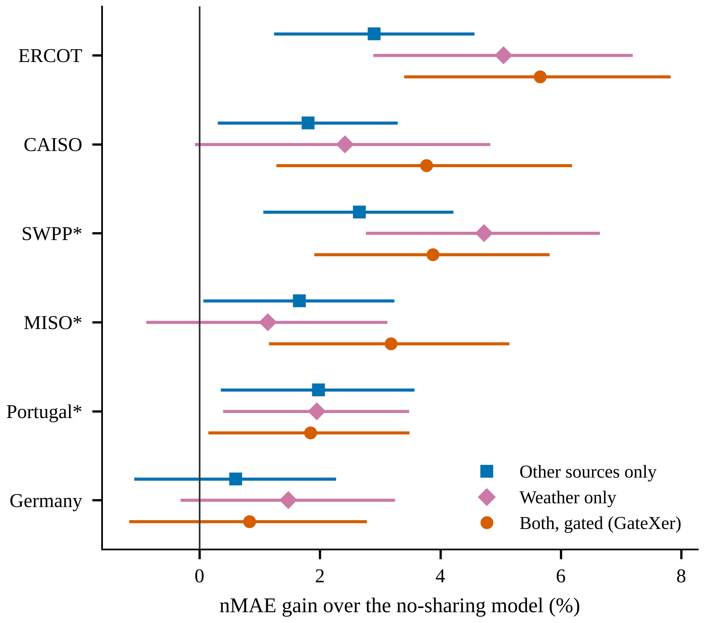
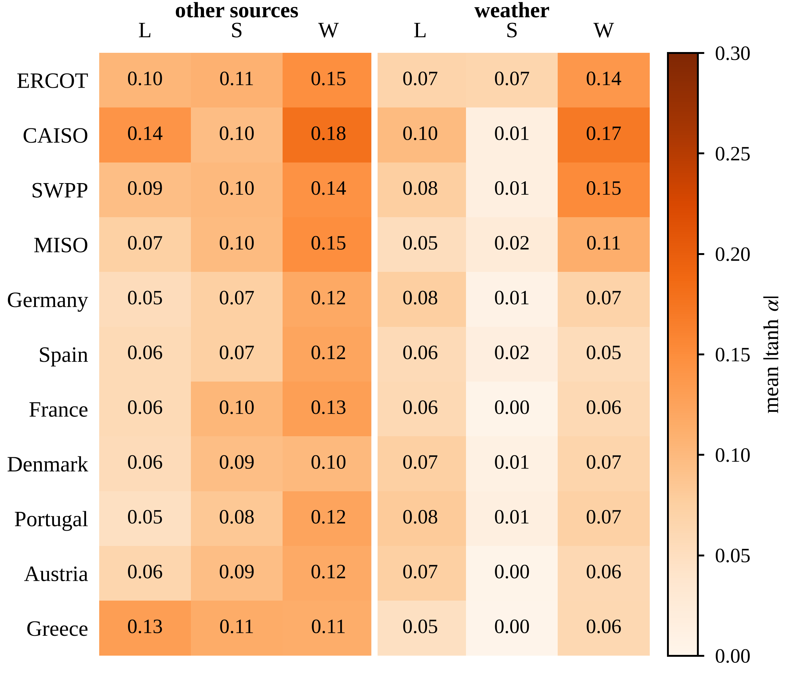
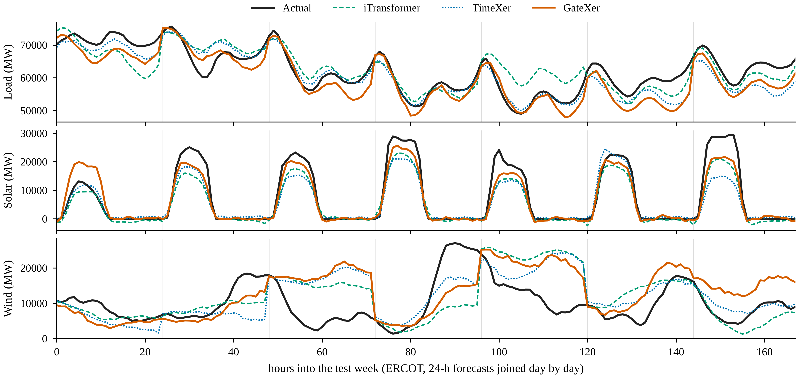

# Results

All numbers come from real runs recorded in [`results/results_all.csv`](../results/results_all.csv) and the bootstrap files in `results/`. Regenerate the tables with `python analysis/make_tables.py`. nMAE = MAE / mean actual (lower is better); gain = 1 - nMAE(GateXer) / nMAE(reference).

## 1. Main comparison, plain protocol

| Grid | GateXer nMAE | Strongest baseline | Its nMAE | Gain % | 95% CI |
|---|---|---|---|---|---|
| ERCOT | 0.1497 | iTransformer | 0.1611 | 7.1 | [5.0, 9.2] |
| CAISO | 0.1451 | iTransformer | 0.1542 | 5.9 | [3.6, 8.0] |
| SWPP | 0.1548 | iTransformer | 0.1689 | 8.4 | [6.3, 10.4] |
| MISO | 0.1650 | TimeXer | 0.1752 | 5.8 | [4.0, 7.6] |
| Germany | 0.1795 | iTransformer | 0.1884 | 4.8 | [2.6, 6.9] |
| Spain | 0.1440 | iTransformer | 0.1496 | 3.8 | [1.8, 5.7] |
| France | 0.1681 | TimeXer | 0.1723 | 2.5 | [0.5, 4.5] |
| Denmark | 0.2404 | TimeXer | 0.2463 | 2.4 | [0.8, 4.0] |
| Portugal | 0.1953 | iTransformer | 0.2032 | 3.9 | [2.0, 5.7] |
| Austria | 0.2587 | TimeXer | 0.2653 | 2.5 | [1.0, 3.9] |
| Greece | 0.1787 | iTransformer | 0.1891 | 5.5 | [3.3, 7.7] |
| India (stress case, not in the average) | 0.0970 | iTransformer | 0.0969 | -0.1 | [-4.0, 3.5] |

Mean gain over the 11 main grids: 4.8% (range 2.4 to 8.4).

Mean per-target gain over the strongest baseline, 11 grids: load 6.2%, solar 8.6%, wind 2.3%

For single-seed runs the mean gain over the 11 grids is 4.0% (range 1.3 to 7.1%).
The strongest baseline differs by grid: iTransformer on seven grids, TimeXer on four. GateXer has the lowest error on every one of the 11 main grids.

## 2. Horizon

Mean over the 11 grids, single-seed means, average of the three sources:

| Horizon | GateXer | DLinear | TimeXer | iTransformer | PatchTST |
|---|---|---|---|---|---|
| 1 h | 0.0555 | **0.0466** | 0.0742 | 0.0663 | 0.0714 |
| 6 h | **0.1535** | 0.1948 | 0.1626 | 0.1645 | 0.1697 |
| 24 h | **0.2360** | 0.2438 | 0.2425 | 0.2428 | 0.2442 |

DLinear is best at the first hour, where the answer is close to the latest observation. GateXer is best from the middle of the horizon on.

## 3. Corrected protocol (yesterday-correction)

Every model that supports it predicts a correction on yesterday's values. Validation error improved in 25 of 25 model/grid cases, and the test error changed on average by: TimeXer -9.1%, PatchTST -6.8%, no-sharing control -3.4%, GateXer -3.1%, iTransformer -3.0%.

| Grid | GateXer nMAE | Strongest baseline | Its nMAE | Gain % | 95% CI |
|---|---|---|---|---|---|
| ERCOT | 0.1474 | TimeXer | 0.1495 | 1.4 | [-0.8, 3.5] |
| CAISO | 0.1461 | TimeXer | 0.1461 | 0.1 | [-1.8, 1.9] |
| Germany | 0.1766 | TimeXer | 0.1776 | 0.6 | [-1.4, 2.6] |
| Spain | 0.1435 | TimeXer | 0.1436 | 0.1 | [-1.4, 1.6] |
| India (stress case, not in the average) | 0.0910 | TimeXer | 0.0914 | 0.5 | [-1.2, 2.1] |

All intervals include zero: **GateXer and TimeXer are tied** under this protocol. GateXer remains ahead of corrected iTransformer and PatchTST on four of the five grids.

## 4. Which kind of sharing helps?

Gain over the no-sharing control (3-seed ensembles). The control is GateXer without sharing for ERCOT, CAISO and Germany, and the `ci` model (no sharing, no FAMO, no trend split) for SWPP, MISO and Portugal, so only the first three rows isolate sharing cleanly.

| Grid | Control | Full GateXer | Sources only | Weather only |
|---|---|---|---|---|
| ERCOT | GateXer without sharing | 5.7 | 2.9 | 5.1 |
| CAISO | GateXer without sharing | 3.8 | 1.8 | 2.4 |
| SWPP | ci (no sharing, no FAMO, no trend split) | 3.9 | 2.7 | 4.7 |
| MISO | ci (no sharing, no FAMO, no trend split) | 3.2 | 1.7 | 1.1 |
| Portugal | ci (no sharing, no FAMO, no trend split) | 1.8 | 2.0 | 1.9 |
| Germany | GateXer without sharing | 0.8 | 0.6 | 1.5 |

Sharing with other sources and sharing with weather both contribute, in different amounts on different grids; the best fixed choice changes from grid to grid, which is the motivation for letting gates decide.

## 5. Design check: independent vs always-on vs gated

Mean test nMAE of the three single-seed runs:

| Grid | Independent | Always-on mixing | Gated (GateXer) |
|---|---|---|---|
| ERCOT | 0.1640 | 0.1613 | **0.1572** |
| CAISO | 0.1562 | 0.1552 | **0.1525** |
| Germany | 0.1865 | 0.1902 | 0.1863 |

On Germany, always-on mixing is clearly worse than independent forecasters while the gated model matches them: the gates stay near closed where sharing does not help.

## 6. Other checks

* **Without FAMO** (equal loss weights) GateXer still beats the strongest baseline on ERCOT, CAISO and Germany, so the gain is not only a loss-balancing effect.
* **Trend/remainder split:** no measurable benefit.
* **Learned gates:** |tanh(alpha)| is at most 0.18, so cross-source and weather contributions are modest corrections. The wind source opens its source gate the most; the solar weather gate stays near zero.

## 7. Cost

| Model | Parameters | Median time per run (Kaggle GPU) |
|---|---|---|
| DLinear | 8 k | 14 s |
| iTransformer | 79 k | 35 s |
| PatchTST | 100 k | 61 s |
| GateXer | 633 k | 98 s |
| TimeXer | 1.34 M | 125 s |

## 8. A week of forecasts (ERCOT)

## 9. Stress case: all-India series

Gain over the strongest baseline in the plain protocol: -0.1% (interval [-4.0, 3.5]). See `LIMITATIONS.md`.
